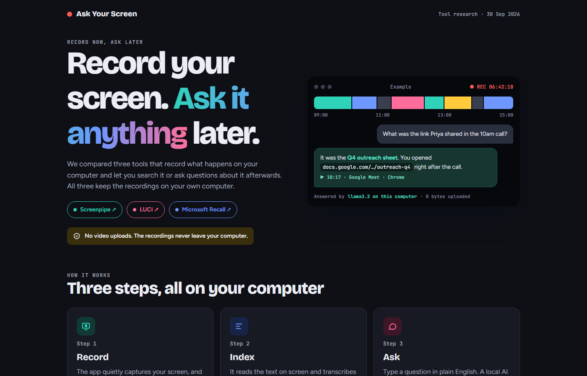

<div align="center">

# 🔴 Ask Your Screen

**Record your screen. Ask it anything later.**

A one-page guide comparing local tools that record what happens on your computer and let you search it or ask questions about it, without uploading a single frame.

[](https://smit02k.github.io/ask-your-screen/)

<a href="https://smit02k.github.io/ask-your-screen/"></a>

</div>

## What's inside

| Section | What you get |
| --- | --- |
| **At a glance** | Cards for each tool with pros, cons and pricing |
| **Side by side** | A feature table: privacy, platforms, hardware, disk space, agent support, price |
| **Setup guide** | Prerequisites and step-by-step setup for each tool |
| **Q&A** | Answers to common questions on cost, privacy, hardware and risk, each with a source |
| **Recommendation** | A two-week pilot plan |

## The tools compared

| | Screenpipe | LUCI | Microsoft Recall |
| --- | :---: | :---: | :---: |
| Keeps recordings local | ✅ | ✅ | ✅ |
| Ask questions in plain English | ✅ | ✅ | ❌ |
| Mac / Windows / Linux | ✅ / ✅ / ✅ | ✅ / ✅ / ❌ | ❌ / Copilot+ only / ❌ |
| Works with Claude & agents (MCP) | ✅ | ✅ | ❌ |
| Price | Free, or from $21/mo | Free (4-hour sessions) | Free |

**Verdict:** pilot **Screenpipe + Ollama**, with LUCI as the backup.

## Run it locally

It's a single HTML file with no build step. Clone the repo and open `index.html` in any browser.

```bash
git clone https://github.com/smit02K/ask-your-screen.git
```

---

<sub>Researched 30 Sep 2026. Prices and features change, so check each vendor's site before buying.</sub>
